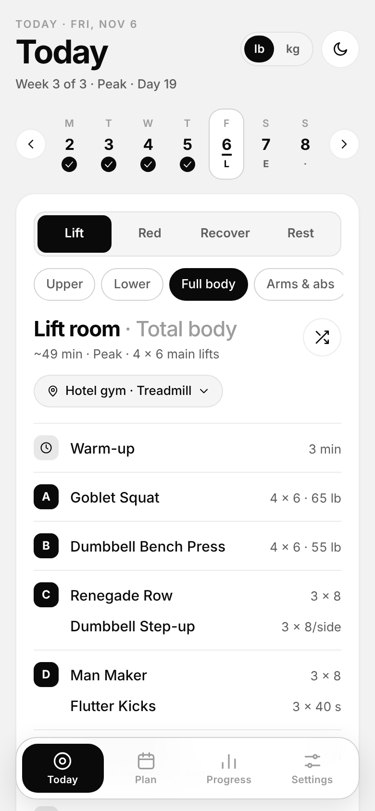
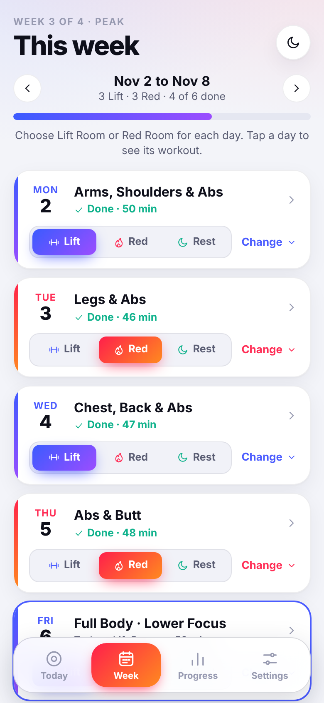
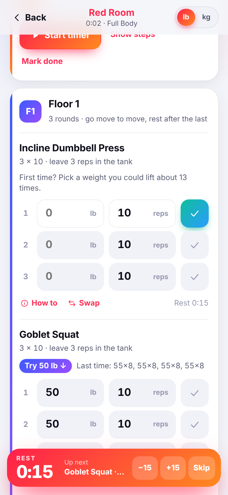
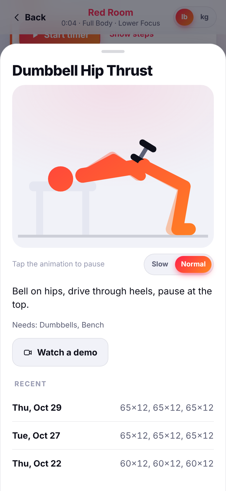
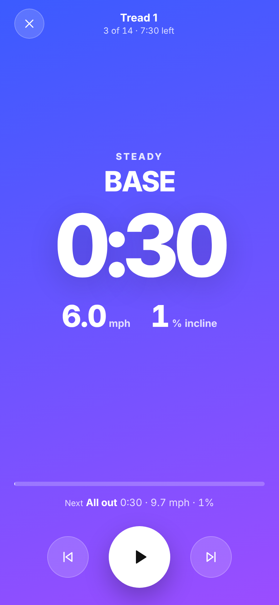
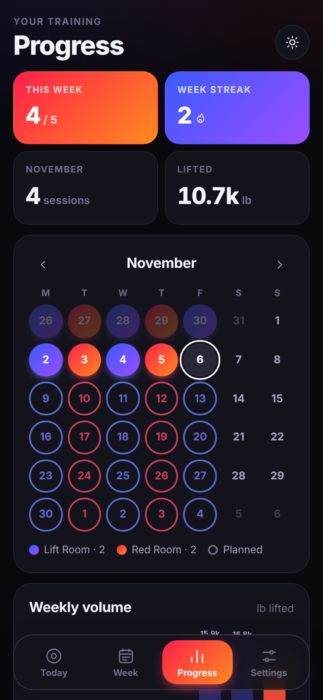

# Forge: your studio week, anywhere

Forge gives you a Barry's-style week of strength and cardio, at home or on the
road. Every day has a **body-part focus** (Arms, Shoulders & Abs; Legs & Abs;
Chest, Back & Abs; Abs & Butt; Full Body with a lower or upper focus), and you
choose the room:

- **Lift Room**: strength. Heavier weights, lower reps, all on the floor.
- **Red Room**: treadmill intervals alternating with floor strength circuits.

Workouts adapt to wherever you are: your usual gym, a hotel gym, a hotel room
floor or a park. Everything runs on your device, no account, works offline.

| Today | Week | Workout | How to | Treadmill timer | Progress |
|---|---|---|---|---|---|
|  |  |  |  |  |  |

## How it's laid out

Four tabs:

- **Today**: the day's focus, a big **Lift Room / Red Room / Rest** switch and
  one Start button. Below it: what's in the workout, where you're training (tap
  to switch when you travel), and a one-tap way to log a studio class instead.
- **Week**: all seven days, each with its own Lift / Red / Rest switch, and
  **Change** to pick a different focus or swap with another day.
  Changes apply to that day only; **Save this week as usual** makes it your
  default for every week.
- **Progress**: workouts this week against your goal, week streak, a month
  calendar colored by room, weekly volume, personal bests and history.
- **Settings**: lb / kg (mph / km/h), light / dark / auto, weekly goal, session
  length, the 4-week cycle, equipment, treadmill speeds, rest timers, backup.

## The program

- **Default week**:

  | Day | Focus | Room |
  |---|---|---|
  | Mon | Arms & Shoulders, with abs | Lift |
  | Tue | Legs, with abs | Red |
  | Wed | Chest & Back, with abs | Lift |
  | Thu | Abs & Butt | Red |
  | Fri | Full Body, lower focus | Lift |
  | Sat | Full Body, upper focus | Red |
  | Sun | Rest | |

  Everything is swappable: flip any day between Lift Room, Red Room and Rest,
  change its focus once or every week, or **swap two days** (room and focus
  trade places for that week). Abs are built into every session (a core move
  in the last Lift block, and every Red Room floor circuit ends on core).
- **Dumbbells & bodyweight only** (on by default), like the studio floor: every
  exercise uses dumbbells, a bench or just your body (push-ups, planks, lunges).
  Even at a full gym it skips barbells, machines, cables, kettlebells, bands and
  pull-up bars. Turn it off in Settings → Where you train to use them.
- **4-week cycles, all year**: Base (3 x 10), Build (4 x 8), Peak (4 x 6), then a
  lighter Deload week, and repeat. Main lifts stay the same through a cycle so
  you can add weight; accessories rotate weekly.
- **Red Room**: warm-up, then two rounds of treadmill block + floor circuit
  (dumbbells, bench, bands, bodyweight), then a cool-down. Treadmill blocks use
  your own Recover / Base / Push / All out speeds (pyramids, hill climbs,
  sprint ladders, tempo builds) and get a little faster each week. No treadmill?
  The same blocks become bike, rower, outdoor run or bodyweight cardio.
- **Lift Room**: warm-up, two main lifts, supersets, optional cardio finisher,
  cool-down.
- **Weight suggestions** from your last session: hit every rep and it adds 5 lb
  (2 to 2.5 kg); when the reps change it works out the right weight.

## Exercise animations

Every exercise (all 107) has its own animation showing the movement, drawn in
the app's colors with the equipment it uses: dumbbells, barbell, kettlebell,
bench, cable machine, band, pull-up bar, wall or door.

- In a workout, each exercise has a moving thumbnail. Tap it (or **How to**) for
  a large player with **Slow** and **Normal** speed; tap the player to pause.
- In **Swap**, every option shows its animation so you can compare moves.
- On Today, tap any exercise in "What's in it" to watch it before you start.
- The interval timer plays the move for warm-ups and bodyweight cardio
  (jumping jacks, high knees, burpees, mountain climbers and more).
- With Reduce Motion turned on in your phone settings, animations step between
  positions instead of moving smoothly.

They are built from a small posable figure: each motion is a few keyframes, and
knees and elbows are solved with inverse kinematics so feet stay planted and
hands stay on the floor, bar or bench. Everything works offline.

## Workout mode

Step chips at the top show where you are and jump to any block. Log each set
with one tap, and a rest timer starts showing what's next. Swap any exercise
(it remembers), see form cues and a demo link, and run a full-screen interval
timer whose color tells you the effort: blue for easy, purple for base, orange
for push, red for all out. The screen stays awake while you train.

## Run it

It is a static site with no build step.

```bash
npm start          # from the repository root, then open http://localhost:8080/fit/
npm test           # includes the Forge program and unit tests
```

### Put it on your phone

Turn on GitHub Pages for this repository (Settings → Pages → Deploy from a
branch, pick the branch with this code, `/ (root)`), then open
`https://<your-user>.github.io/<repo>/fit/` on your phone.

- **iPhone**: Safari → Share → **Add to Home Screen**.
- **Android**: Chrome → menu → **Install app**.

## Code

```
fit/index.html        app shell
fit/css/styles.css    design tokens (light + dark), Lift blue / Red red-orange
fit/js/app.js         screens, workout mode, rest and interval timers
fit/js/program.js     weekly plan, session builder, cycles, load suggestions (pure, unit-tested)
fit/js/exercises.js   exercise library, equipment, locations
fit/js/units.js       lb / kg and mph / km/h helpers (pure, unit-tested)
fit/js/store.js       local-first storage, migration, backup / restore
fit/js/timer.js       beeps, vibration, screen wake lock, countdown
fit/js/anim.js        exercise animations: posable figure, keyframes, IK, props
fit/sw.js             offline cache, scoped to fit/
tests/fit-program.test.mjs
```

Sessions are generated from the date, so a day always shows the same workout
until you shuffle it. Data is saved in this browser only, so use
**Settings → Back up** now and then.
